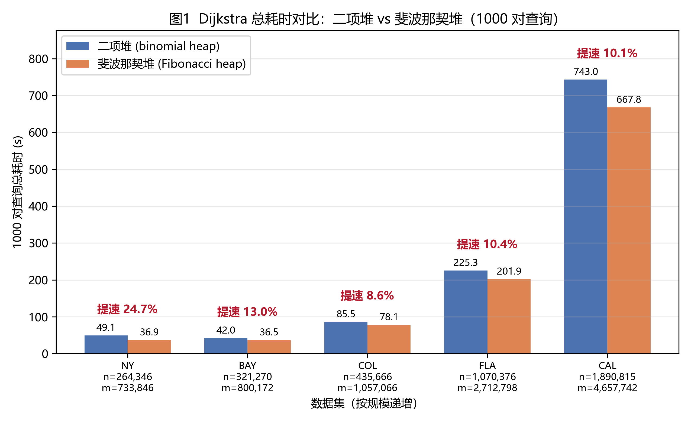
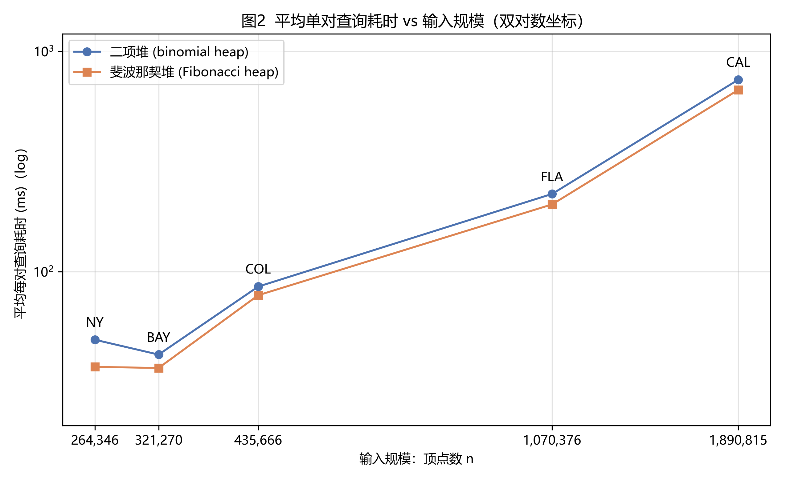

# 性能测试结果（最短路径：二项堆 vs 斐波那契堆）

## 测试环境

- 操作系统：Windows 11 家庭中文版
- CPU：AMD Ryzen 9 8945HX with Radeon Graphics
- 内存：32 GB（系统显示 31.8 GB）
- 编译器：g++ 8.1.0（MinGW-W64，x86_64-posix-seh-rev0）
- C++ 标准：C++17
- 编译优化：-O2

## 测试数据

使用 DIMACS 第 9 届实现挑战（Shortest Paths）的真实美国路网数据（`.gr` 格式），共 5 个数据集：

| 数据集 | 顶点 n | 弧 m | 说明 |
|--------|------:|------:|------|
| NY  | 264346 | 733846 | 纽约 |
| BAY | 321270 | 800172 | 旧金山湾区 |
| COL | 435666 | 1057066 | 科罗拉多 |
| FLA | 1070376 | 2712798 | 佛罗里达 |
| CAL | 1890815 | 4657742 | 加州（最大）|

数据说明：

- 这是一个**无向路网图**：顶点为路口/道路节点，边为道路，权重为道路长度（距离）。
- 无向：每条道路以正反两条有向弧存储（如 `a 1 2 803` 与 `a 2 1 803`），因此 m 条弧 ≈ m/2 条实际道路。
- 所有权重为正，满足 Dijkstra 算法的适用前提。
- `.gr` 文件包含三类行：`c` 注释、`p sp n m` 顶点/弧数、`a u v w` 一条弧。

规模从 26 万到 189 万顶点，跨越多个数量级，足以观察两种堆在不同规模下的表现。

## 测试方法

- 对每个数据集，读入图后，用**固定随机种子（seed = 42）** 预先生成 **1000 对 (起点, 终点)** 查询。
- 二项堆（`dijkstra`）与斐波那契堆（`dijkstra_fib`）**共用同一批 1000 对查询**，保证对比公平。
- 计时用 `<chrono>` 的 `high_resolution_clock`，读图耗时不计入查询计时。
- **正确性交叉验证**：对每对查询，若最短距离可达（不为 -1），累加到 checksum（`int64_t`）。两种堆的 checksum 必须完全相等，以此验证结果一致。

## 测试结果（每个数据集 1000 对查询，单次运行）

| 数据集 | n | m | 二项堆 总耗时(ms) | 斐波那契 总耗时(ms) | 二项堆 平均(ms/对) | 斐波那契 平均(ms/对) | 提速 |
|--------|------:|------:|------:|------:|------:|------:|------:|
| NY  | 264346 | 733846 | 49065.7 | 36947.4 | 49.066 | 36.947 | 24.7% |
| BAY | 321270 | 800172 | 42003.1 | 36522.4 | 42.003 | 36.522 | 13.0% |
| COL | 435666 | 1057066 | 85496.5 | 78106.8 | 85.496 | 78.107 | 8.6% |
| FLA | 1070376 | 2712798 | 225262.0 | 201912.1 | 225.262 | 201.912 | 10.4% |
| CAL | 1890815 | 4657742 | 742975.4 | 667803.4 | 742.975 | 667.803 | 10.1% |

> 提速 = (二项堆总耗时 − 斐波那契总耗时) / 二项堆总耗时。

*图1：各数据集上两种堆完成 1000 对查询的总耗时对比（柱顶数字为总耗时，秒）。*

## 正确性交叉验证（checksum）

checksum = 1000 对查询中最短距离之和（不可达的查询跳过不计入）。所有数据集上可达对数均为 1000/1000（路网为强连通图）。

| 数据集 | checksum(二项堆) | checksum(斐波那契) | 是否一致 |
|--------|------:|------:|:---:|
| NY  | 281440067 | 281440067 | ✅ |
| BAY | 261521004 | 261521004 | ✅ |
| COL | 818133359 | 818133359 | ✅ |
| FLA | 1769491714 | 1769491714 | ✅ |
| CAL | 4602554821 | 4602554821 | ✅ |

## 分析与讨论

**1. 实测结果与理论复杂度的对应**

- 二项堆版 Dijkstra：`extract-min` 与 `decrease-key` 均为 O(log n)，总复杂度 O((n + m) log n)。
- 斐波那契堆版：`extract-min` 摊还 O(log n)，`decrease-key` 摊还 O(1)，总复杂度 O(m + n log n)。
- 路网是稀疏图（5 个数据集 m/n ≈ 2.4～2.8）。随机查询下 Dijkstra 的搜索范围接近全图，松弛成功次数（每次松弛至多触发一次 `decrease-key`，量级 O(m)）远多于 `extract-min` 次数（量级 O(n)）。把 `decrease-key` 从 O(log n) 降到摊还 O(1) 的收益因此被持续放大——这与实测"5 个数据集全面提速 8.6%～24.7%"定性一致。

**2. 提升幅度为何低于渐近差距**

理论上 O(m + n log n) 对 O((n + m) log n) 的优势远不止 10% 量级，实测差距被压缩的原因主要有两点：

- 二项堆用数组存储、斐波那契堆是纯指针结构：后者的节点分散在堆内存各处，`decrease-key` 的切断/级联切断对指针的随机访问缓存局部性差，常数因子明显更大；
- 实测耗时中相当一部分是图遍历本身（邻接表扫描、距离数组读写），这部分两种堆完全相同，摊薄了堆操作上的差距。

**3. 规模扩展性（图2）**

*图2：平均每对查询耗时随顶点数 n 的变化（双对数坐标）。*

双对数坐标下两条曲线近似平行直线，斜率约 1.4（二项堆）～1.5（斐波那契堆）：NY→CAL 顶点数扩大 7.15 倍，平均耗时分别扩大约 15.1 倍与 18.1 倍，明显高于同区间 n·log n 的理论增速（约 1.07 倍幂）。说明除算法复杂度外，还有两个因素在起作用：随机查询对的搜索范围随地图扩大而增长，以及大图的邻接表、距离数组与堆结构超出缓存容量、访存逐渐成为瓶颈。两堆曲线几乎等距平行，说明这一扩展性差异主要由问题本身决定，与堆的选择关系不大。

**4. 数据集之间的波动**

- NY 提速最大（24.7%），COL 最小（8.6%）。NY 的 m/n ≈ 2.78 为五者最高，单位顶点触发的 `decrease-key` 更多，斐波那契堆的优势相应更大；COL 的 m/n ≈ 2.43 最低，这与提速排序吻合，但 BAY 与 COL 的 m/n 接近而提速相差 4 个百分点，说明还有测量波动与图结构细节的影响。
- BAY 规模大于 NY，单对耗时反而更低（42.0ms vs 49.1ms），同样说明耗时不只由 n 决定，还受平均度、边权分布、查询对搜索范围等影响。
- 本表为**单次运行**结果（查询由固定种子生成，重复运行查询相同，计时会有波动）；如需更稳健的数字，可对每个数据集多次运行取平均。

## 结论

1. **正确性**：5 个数据集上，二项堆与斐波那契堆跑同一批 1000 对查询得到的 checksum 完全一致，交叉验证通过，两种实现结果均正确。
2. **性能**：斐波那契堆在全部 5 个数据集上均快于二项堆，提速约 8.6%～24.7%；提速主要来自 `decrease-key` 摊还 O(1) 对 O(log n) 的优势，在松弛频繁的稀疏路网场景下被放大。
3. **数据结构选择**：对本项目这类稀疏路网 + 大批量随机查询的 Dijkstra 应用，斐波那契堆是两种实现中更优的数据结构，且其优势随图规模增长保持稳定（图2）；若追求更小的常数与更简单的实现，二项堆（数组存储）在中小规模图上是实用性很好的替代。
